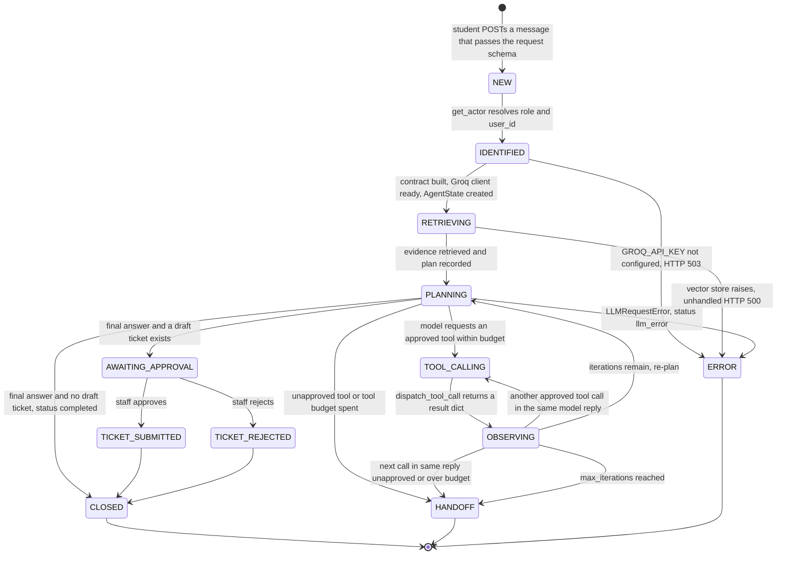

# Session State Model — Week 6

## 1. Purpose

This document is the explicit state model for one UniSupport AI
student-support session: every state a session can be in, every
transition allowed between them, who or what causes each transition, and
which data lives only for the session versus in persistent memory. It is
derived from the Week 5 bounded agent as it actually runs
(`agent-backend/agent/orchestrator.py`, `agent/state.py`,
`agent/contract.py`), the Week 4 tools (`tools/registry.py`,
`tools/tickets.py`), and the human-approval endpoints in `main.py`. It
describes the behaviour that exists today and marks clearly where the
team's intended design (persistent case-history memory, a stored
`current_state`, and so on) is not implemented yet. The teammate building
the state store (Task 2) should treat Section 9 as the list of gaps to
close. In code today, a **session is one agent run**: one
`POST /api/v1/agent/student-support` request. There is no multi-turn
conversation object yet.

> **Authority boundary (unchanged from the Agent Task Contract):** the
> agent can at most create a `PENDING_APPROVAL` draft ticket. Only a staff
> member, through a separate HTTP call, can move it to `SUBMITTED` or
> `REJECTED`. The agent never makes admissions, grading, disciplinary or
> fee decisions.

Transition causes used throughout:

- **AGENT**: a decision returned by the model (final answer or tool request).
- **DETERMINISTIC**: application code, config limits, schema/guard checks.
- **HUMAN**: the student sending a request, or staff approving/rejecting.

---

## 2. State diagram

How the diagram relates to the run's `status` field (`AgentState.status`):

| Model state | `AgentState.status` | HTTP result |
|---|---|---|
| NEW, IDENTIFIED, RETRIEVING, PLANNING, TOOL_CALLING, OBSERVING | `running` (not distinguished in code) | — |
| CLOSED (direct from PLANNING) | `completed` | 200 |
| AWAITING_APPROVAL | `human_approval_required` | 200 |
| HANDOFF | `tool_not_approved`, `max_tool_calls_reached`, `max_iterations_reached` | 200 |
| ERROR | `llm_error` | 200 |
| ERROR (before/outside the loop) | no `AgentState` returned | 503 (config) / 500 (retrieval) |
| TICKET_SUBMITTED, TICKET_REJECTED, CLOSED (after approval) | not tracked by the run; lives in `tickets.status` (`SUBMITTED` / `REJECTED`) | 200 from approve/reject endpoint |

**Iteration limit.** `max_iterations = 4` (`AGENT_MAX_ITERATIONS`,
`config.py`) counts PLANNING entries (model decisions). `max_tool_calls =
3` (`MAX_TOOL_CALLS`) counts TOOL_CALLING executions. When the tool budget
is spent, PLANNING calls the model with `tools=None, tool_choice="none"` so
it should answer. If the model still asks for a tool, the session goes
to HANDOFF (`max_tool_calls_reached`). When the iteration budget is spent
and the last iteration ended in OBSERVING, the `while` guard exits and the
session goes to HANDOFF (`max_iterations_reached`). Both return
`SAFE_LIMIT_RESPONSE`, which tells the student to rephrase or contact
staff. A session can never loop forever or stay `running`.

---

## 3. State table

| State | Meaning | Entry condition | Allowed next states |
|---|---|---|---|
| NEW | A student message has been accepted by the API. | Body passes `StudentSupportRequest` (1–2000 chars, not blank). Invalid bodies get HTTP 422 and never enter NEW. | IDENTIFIED |
| IDENTIFIED | The caller's role (`student`/`staff`/`guest`) and `user_id` are known; the run's contract and model client exist. | `get_actor` has resolved the `X-User-Role` / `X-User-Id` headers. An unknown role becomes `guest`. This is a header simulation, not authentication. | RETRIEVING, ERROR |
| RETRIEVING | Policy evidence is fetched from the vector store and the plan/budget is recorded. | `AgentState` created with `status="running"`. | PLANNING, ERROR |
| PLANNING | Plan/Decide: the model chooses a final answer or one or more tool calls. | `iteration_count < max_iterations`; `iteration_count` is incremented on entry. | TOOL_CALLING, CLOSED, AWAITING_APPROVAL, HANDOFF, ERROR |
| TOOL_CALLING | Act/Tool: the application (not the model) validates, authorizes and runs one tool via `dispatch_tool_call`. | Tool is on the allow-list **and** `tool_call_count < max_tool_calls`. | OBSERVING |
| OBSERVING | Observe: the tool result (success or failure) is recorded as a step and fed back to the model. A successful `create_support_ticket` adds its ID to `drafted_ticket_ids`. | `dispatch_tool_call` returned (it never raises). | TOOL_CALLING, PLANNING, HANDOFF |
| AWAITING_APPROVAL | The run ended holding a `PENDING_APPROVAL` draft ticket; the agent's authority is exhausted and staff take over. | Model gave a final answer **and** `drafted_ticket_ids` is non-empty. | TICKET_SUBMITTED, TICKET_REJECTED |
| TICKET_SUBMITTED | Staff approved the draft (the team's "TICKET_CREATED"). | `POST /support-tickets/{id}/approve` with `X-User-Role: staff` on a `PENDING_APPROVAL` ticket. | CLOSED |
| TICKET_REJECTED | Staff rejected the draft. | `POST /support-tickets/{id}/reject` with `X-User-Role: staff` on a `PENDING_APPROVAL` ticket. | CLOSED |
| CLOSED | The request is resolved: either a grounded/tool-backed answer (`completed`) or a staff decision on the ticket. | See transitions. | — (terminal) |
| HANDOFF | The agent stopped at the edge of its authority or budget and directed the student to staff. | `tool_not_approved`, `max_tool_calls_reached` or `max_iterations_reached`. | — (terminal) |
| ERROR | The session failed safely with no internal details shown. | `llm_error` inside the loop, or a 503/500 before the loop. | — (terminal) |

---

## 4. Transition table

| # | From | To | Trigger | Guard condition | Caused by |
|---|---|---|---|---|---|
| T1 | [start] | NEW | Student sends `POST /api/v1/agent/student-support` | Body valid per `StudentSupportRequest` | HUMAN |
| T2 | NEW | IDENTIFIED | FastAPI dependency `get_actor` runs | None (always succeeds; unknown role → `guest`) | DETERMINISTIC |
| T3 | IDENTIFIED | RETRIEVING | `run_agent` builds contract + `GroqClient`, creates `AgentState` | `GROQ_API_KEY` configured | DETERMINISTIC |
| T4 | IDENTIFIED | ERROR | `GroqClient.__init__` raises `LLMConfigurationError` | API key missing → HTTP 503 | DETERMINISTIC |
| T5 | RETRIEVING | PLANNING | `_retrieve_evidence` returns; `plan` recorded | None (zero sources is allowed; the prompt handles "no evidence") | DETERMINISTIC |
| T6 | RETRIEVING | ERROR | Vector store / embedding exception | Not caught today → HTTP 500 (see mismatch M7) | DETERMINISTIC |
| T7 | PLANNING | TOOL_CALLING | Model reply contains a tool call | `contract.is_approved_tool(name)` **and** `tool_call_count < max_tool_calls` | AGENT |
| T8 | PLANNING | CLOSED | Model reply has no tool calls | `drafted_ticket_ids` is empty → status `completed` | AGENT |
| T9 | PLANNING | AWAITING_APPROVAL | Model reply has no tool calls | `drafted_ticket_ids` is non-empty → status `human_approval_required` | DETERMINISTIC (the model only chose to answer; code decides the hand-off) |
| T10 | PLANNING | HANDOFF | Model requests a tool not on the allow-list | `not contract.is_approved_tool(name)` → `tool_not_approved`; tool **not** executed | DETERMINISTIC |
| T11 | PLANNING | HANDOFF | Model requests a tool after the budget is spent | `tool_call_count >= max_tool_calls` → `max_tool_calls_reached` | DETERMINISTIC |
| T12 | PLANNING | ERROR | `client.create_completion` raises `LLMRequestError` (timeout, rate limit, connection, empty reply) | — → `llm_error` | DETERMINISTIC |
| T13 | TOOL_CALLING | OBSERVING | `dispatch_tool_call` returns `{success: true/false, ...}` | Always (failures such as a guest role, bad arguments, no data or DB down come back as `success: false` and are observed, not fatal) | DETERMINISTIC |
| T14 | OBSERVING | TOOL_CALLING | Same model reply contains another tool call | Approved **and** within tool budget | AGENT |
| T15 | OBSERVING | HANDOFF | Same model reply contains another tool call | Unapproved (`tool_not_approved`) or over budget (`max_tool_calls_reached`) | DETERMINISTIC |
| T16 | OBSERVING | PLANNING | All tool calls in the reply processed | `iteration_count < max_iterations` | DETERMINISTIC |
| T17 | OBSERVING | HANDOFF | All tool calls in the reply processed | `iteration_count >= max_iterations` → `max_iterations_reached` | DETERMINISTIC |
| T18 | AWAITING_APPROVAL | TICKET_SUBMITTED | Staff calls `/support-tickets/{id}/approve` | `actor.role == "staff"` **and** ticket status is `PENDING_APPROVAL` | HUMAN |
| T19 | AWAITING_APPROVAL | TICKET_REJECTED | Staff calls `/support-tickets/{id}/reject` | `actor.role == "staff"` **and** ticket status is `PENDING_APPROVAL` | HUMAN |
| T20 | TICKET_SUBMITTED | CLOSED | Ticket reaches a final status | None: the ticket is final and cannot change again | DETERMINISTIC |
| T21 | TICKET_REJECTED | CLOSED | Ticket reaches a final status | None: the ticket is final and cannot change again | DETERMINISTIC |

**High-impact actions and AWAITING_APPROVAL.** In code, the
`create_support_ticket` tool only inserts a *draft* (`PENDING_APPROVAL`);
it does not submit or route anything. The high-impact action, a ticket
becoming `SUBMITTED`, is reachable **only** through AWAITING_APPROVAL
(T18), and only by a staff HTTP call that the agent cannot make. There
is no separate escalation action in code (see M3). Escalating a
high-impact request (admissions, grades, discipline, fees) means drafting
a ticket, so it follows the same path.

**Memory guard.** No guard in this table reads persistent memory. Every
guard reads only values produced inside the current run by code
(`tool_call_count`, `iteration_count`, `drafted_ticket_ids` from this run's
successful tool result, `actor.role` from this request's headers) or by a
human (staff role on the approve/reject call). Memory therefore cannot
trigger T7 (ticket creation), T9 (approval hand-off) or T18/T19
(approval). See Section 6 for the rule once memory is added.

---

## 5. Session state fields

Session state lives in one `AgentState` object (plus local variables in
`run_agent`) for exactly one run. Everything here is discarded once the
HTTP response is returned. The "In code today" column shows which
fields exist and which the state store (Task 2) must add.

| Field | Type | Example | Set by | Cleared when | In code today |
|---|---|---|---|---|---|
| `session_id` | `str` (UUID4) | `"b1e4…-9c2a"` | DETERMINISTIC, on entering RETRIEVING (`AgentState` default factory) | Response returned | As `run_id` |
| `student_id` | `str` | `"2100712345"` (default `"anonymous"`) | DETERMINISTIC from the `X-User-Id` header (`get_actor`) | Response returned | Only as `actor.user_id` in `run_agent`; **not stored on `AgentState`** |
| `role` | `"student" \| "staff" \| "guest"` | `"student"` | DETERMINISTIC from `X-User-Role` | Response returned | Only as `actor.role` |
| `message` | `str` | `"I can't log in to the student portal…"` | HUMAN (student) | Response returned | Yes |
| `active_case_id` | `str \| None` | `"DRAFT-001"` | DETERMINISTIC, at OBSERVING after a successful `create_support_ticket` in **this run** | Response returned (the ticket itself persists in `tickets.db`) | As `drafted_ticket_ids: list[str]` |
| `intent` | `str \| None` | `"timetable_lookup"` | — | — | **No.** There is no classification step (see M2) |
| `retrieved_sources` | `list[Source]` | `[{document: "Policy_on_remarking…", page: 3}]` | DETERMINISTIC, at RETRIEVING | Response returned | As `sources` |
| `plan` | `str` | `"4 evidence source(s) retrieved; approved tools: …; budget: 4 iteration(s), 3 tool call(s)."` | DETERMINISTIC, at RETRIEVING (`_plan_summary`) | Response returned | Yes |
| `tool_calls` | `list[AgentStep]` where `decision="tool_call"` | `[{tool_name: "check_timetable", tool_arguments: {course_code: "BSE4104"}, tool_result: {...}}]` | AGENT requests, DETERMINISTIC records at OBSERVING | Response returned | Inside `steps` (no separate list) |
| `tool_call_count` | `int` | `1` | DETERMINISTIC, +1 per TOOL_CALLING | Response returned | Yes |
| `steps` | `list[AgentStep]` | full decision trace | DETERMINISTIC at every PLANNING/OBSERVING/stop | Response returned | Yes |
| `iteration_count` | `int` | `2` | DETERMINISTIC, +1 on each PLANNING entry | Response returned | Yes |
| `max_iterations` | `int` | `4` | DETERMINISTIC from config `AGENT_MAX_ITERATIONS` via `AgentTaskContract` | Never (config) | On the contract, not on `AgentState`; echoed in the response |
| `max_tool_calls` | `int` | `3` | DETERMINISTIC from config `MAX_TOOL_CALLS` | Never (config) | On the contract |
| `approval_status` | `"PENDING_APPROVAL" \| "SUBMITTED" \| "REJECTED" \| None` | `"PENDING_APPROVAL"` | DETERMINISTIC on draft creation; HUMAN (staff) on approve/reject | Never in the DB; session copy dropped with the response | **Not on `AgentState`.** It exists only as `tickets.status` in `tickets.db`. Read it from the DB and do not cache it |
| `current_state` | one of the Section 3 states | `"OBSERVING"` | DETERMINISTIC on each transition | Response returned (terminal value could be logged) | **No.** `status` only distinguishes `running` from the 6 terminal statuses |
| `status` | `AgentStatus` | `"human_approval_required"` | DETERMINISTIC (`AgentState.stop`) | Response returned | Yes |
| `response` | `str` | answer text or safe message | AGENT (answer) or DETERMINISTIC (safe messages) | Response returned | Yes |
| model message history | `list[dict]` | system + user + assistant + tool messages | DETERMINISTIC | End of `run_agent` | Local variable `messages`; never returned |

---

## 6. Session state vs persistent memory

**Team decision:** persistent memory is a student's case history (ticket
ID, category, status, date). It is loaded at session start as read-only
context. It must never change category, priority, routing or approval
decisions. **None of this is implemented yet.** `agent/state.py` says
"no memory across runs", and `agent-backend/README.md` lists persistent
case memory as planned.

| Data | Where it lives | Lifetime | Why |
|---|---|---|---|
| `run_id`/`session_id`, `message`, `role`, `student_id` | Session state | One run | Identifies this request only; re-derived from each request's headers |
| `retrieved_sources`, `plan` | Session state | One run | Evidence must be retrieved fresh for each question, not reused from an old one |
| `iteration_count`, `tool_call_count`, `steps`, `status`, `current_state` | Session state | One run | Budgets and guards must reset every run so they can't be exhausted or bypassed across runs |
| model message history | Session state (local) | One run | Prevents old model output from leaking into new decisions |
| `active_case_id` (this run's draft) | Session state | One run | Drives the AWAITING_APPROVAL hand-off; must come from **this** run's tool result |
| Ticket record (`ticket_id`, `category`, `subject`, `description`, `status`, `created_at`, `updated_at`) | Persistent: `tickets.db` (exists today) | Until deleted | It is the case of record that staff act on |
| `approval_status` | Persistent: `tickets.status` | Until deleted | Only HUMAN (staff) can change it; the session may read it but never owns it |
| Case history per student (ticket ID, category, status, date) | Persistent memory (**planned**), derived from `tickets.db` | Across sessions | Lets the agent say "you already have DRAFT-004 pending" without asking again |
| Policy corpus / vector store | Persistent knowledge base (not memory) | Across sessions | Shared reference material, not personal to a student |
| `max_iterations`, `max_tool_calls`, approved tools | Config / `AgentTaskContract` | Process lifetime | Fixed policy; neither the session nor memory may change it |

**Rules for adding memory (Task 2):**

1. Load case history once, during RETRIEVING, into the prompt as read-only
   context. Never write it into `active_case_id`, `approval_status`,
   `drafted_ticket_ids` or any other guard field.
2. No transition guard (T7–T19) may read memory. AWAITING_APPROVAL must
   still require a ticket drafted **in this run**, and approval must
   still require a staff HTTP call.
3. Memory may *inform* the model's wording ("you already have a pending
   ticket"). Code cannot fully stop memory text from influencing the
   model's choice of `category` in a new draft. That risk is limited
   because every draft still needs staff approval. Add a test that the same
   message with and without case history produces the same `category`.

---

## 7. Invalid transitions the code must reject

| # | Invalid transition | Why it is invalid | Rejected today by |
|---|---|---|---|
| X1 | NEW / IDENTIFIED / RETRIEVING → AWAITING_APPROVAL or TICKET_SUBMITTED | A ticket must be drafted by a validated tool call in this run, then approved by staff | Structural: `drafted_ticket_ids` is only appended in `run_agent` after a successful `dispatch_tool_call` |
| X2 | AWAITING_APPROVAL → TICKET_SUBMITTED by AGENT or by a student | Only staff may approve | No approve tool in `TOOL_REGISTRY`; `main.py` approve/reject return 403 for non-staff |
| X3 | TICKET_SUBMITTED ↔ TICKET_REJECTED, or either → PENDING_APPROVAL | A staff decision is final | `tools/tickets.py::_transition_ticket` refuses unless status is `PENDING_APPROVAL` |
| X4 | PLANNING → TOOL_CALLING for a tool not on the allow-list | Outside the agent's authority | `contract.is_approved_tool` check → HANDOFF (`tool_not_approved`); also `dispatch_tool_call` rejects unregistered names |
| X5 | PLANNING/OBSERVING → TOOL_CALLING when `tool_call_count >= max_tool_calls` | Budget exhausted | Guard in `run_agent` → HANDOFF (`max_tool_calls_reached`) |
| X6 | OBSERVING → PLANNING when `iteration_count >= max_iterations` | Budget exhausted | `while` guard → HANDOFF (`max_iterations_reached`) |
| X7 | CLOSED / HANDOFF / ERROR → any state (resuming a finished run) | Terminal states are final; a new message is a new session | Structural: `run_agent` returns on `state.stop(...)`. `AgentState` is not persisted, so it cannot be resumed. A state store must enforce this explicitly |
| X8 | Persistent memory → TOOL_CALLING(`create_support_ticket`), AWAITING_APPROVAL or TICKET_SUBMITTED | Memory is context only | Not applicable yet (no memory). Must be enforced when memory is added (Section 6 rules) |
| X9 | TOOL_CALLING → ERROR because a tool failed | Tool failures are observations, not session failures | `dispatch_tool_call` never raises; failures go to OBSERVING as `success: false` |

---

## 8. Mapping to code

Paths are relative to `agent-backend/`.

| State | Entered in |
|---|---|
| NEW | `main.py:121` `agent_student_support` after `schemas.py:8` `StudentSupportRequest` validates the body |
| IDENTIFIED | `auth.py:28` `get_actor` (FastAPI dependency); `agent/orchestrator.py:81-89` `run_agent` builds contract, `GroqClient`, `ToolContext` |
| RETRIEVING | `agent/orchestrator.py:92-96`: `AgentState(...)`, `llm/service.py:58` `_retrieve_evidence`, `_plan_summary` |
| PLANNING | `agent/orchestrator.py:107-118`: loop guard, `iteration_count += 1`, `client.create_completion` |
| TOOL_CALLING | `agent/orchestrator.py:146-180` → `tools/registry.py:132` `dispatch_tool_call` → `tools/timetable.py::check_timetable` or `tools/tickets.py:42` `create_support_ticket` |
| OBSERVING | `agent/orchestrator.py:181-197`, `_observe` at `agent/orchestrator.py:51` |
| AWAITING_APPROVAL | `agent/orchestrator.py:130-142` → `state.stop("human_approval_required", ...)`; ticket row written as `PENDING_APPROVAL` by `tools/tickets.py:42` |
| TICKET_SUBMITTED | `main.py:176` `approve_support_ticket` → `tools/tickets.py:123` `approve_ticket` → `_transition_ticket` (`tools/tickets.py:99`) |
| TICKET_REJECTED | `main.py:194` `reject_support_ticket` → `tools/tickets.py:127` `reject_ticket` → `_transition_ticket` |
| CLOSED | `agent/orchestrator.py:143` `state.stop("completed", ...)`; or after T18/T19 (implicit: nothing records it) |
| HANDOFF | `agent/orchestrator.py:150-164` (`tool_not_approved`), `166-176` (`max_tool_calls_reached`), `199-206` (`max_iterations_reached`) |
| ERROR | `agent/orchestrator.py:119-122` (`llm_error`); `llm/client.py:30` → `main.py:127-132` (HTTP 503); retrieval exceptions currently surface as HTTP 500 |

Terminal statuses are defined in `agent/contract.py` (`AgentStatus`,
`TERMINAL_STATUSES`). Each is covered by a test in
`tests/test_agent_orchestrator.py`.

---

## 9. Mismatches between the code and the requested model (for Task 2)

| # | Mismatch | Impact | Suggested fix |
|---|---|---|---|
| M1 | **No multi-turn session.** "Session" = one HTTP request (`run_id`); there is no `session_id` that spans messages and no conversation history between requests. | A follow-up message can't refer to the previous one. | State store keyed by `session_id`, with each request as a run inside it. |
| M2 | **No QUERY_CLASSIFIED state / `intent` field.** The model goes straight from evidence to a decision; nothing classifies the query. | The requested state was left out of the diagram rather than invented. | If added, make `intent` advisory and logged only. It must not feed any guard. |
| M3 | **No ESCALATED state or escalation tool.** Escalation of high-impact requests (H5) is prompt-only and is done by drafting a ticket. `route_support_case()` in `docs/architecture/ARCHITECTURE.png` does not exist. | High-impact topics have no code-level filter (already listed as a known limitation in the contract, H5). | Either add an `escalate_case` draft-only tool that goes through AWAITING_APPROVAL, or update the diagram. |
| M4 | **`get_case_status` / `check_case_status()` do not exist.** The Week 4 catalogue has only `check_timetable` and `create_support_ticket`; `ARCHITECTURE.png` also shows `search_university_documents()` (retrieval is not a tool; it always runs). | The architecture diagram overstates the tools. | Update `ARCHITECTURE.png` or implement a read-only `get_case_status` tool. |
| M5 | **No persistent memory, and `tickets.db` has no `student_id` column.** Case history can't be filtered per student. | The team's memory design can't be built on the current schema. | Add `student_id` (from `X-User-Id`) to the `tickets` table at creation, and pass `actor` into `create_support_ticket`. |
| M6 | **A draft can be "lost" behind another terminal status.** If a ticket is drafted and the run then ends with `max_iterations_reached`, `max_tool_calls_reached`, `tool_not_approved` or `llm_error`, the status is **not** `human_approval_required`, even though a `PENDING_APPROVAL` ticket now exists. | The student/frontend isn't told a ticket is pending approval. | Precedence rule: if `drafted_ticket_ids` is non-empty, report AWAITING_APPROVAL (or return both the hand-off reason and the pending ticket). Add a test. |
| M7 | **Retrieval errors are unhandled.** `_retrieve_evidence` is outside any `try`; a Chroma failure becomes an HTTP 500 with no `AgentState`. This contradicts the contract's "every other failure ends the run with a terminal status". | No safe message for the student, and no trace. | Catch it and stop with an explicit status (for example `retrieval_error`) or continue with zero sources. |
| M8 | **No `current_state` field.** `AgentState.status` is `running` for all six active states; the phase can only be inferred from `steps`. | The state store can't report or validate where a session is. | Add `current_state` and a transition function that checks Section 4 and rejects Section 7. |
| M9 | **`student_id`/`role` not on `AgentState`.** `actor` is passed into `run_agent` but not recorded, so traces don't say who made the request. | Audit gap. | Store `actor.user_id` and `actor.role` on the state. |
| M10 | **The run and the ticket are not linked after the run ends.** AWAITING_APPROVAL → TICKET_SUBMITTED/REJECTED → CLOSED happens in `tickets.db` with no reference to the originating `run_id`/session. | The session's final CLOSED is never recorded. | Store `run_id`/`session_id` on the ticket row, or record the transition in the state store. |
| M11 | **No timeout for AWAITING_APPROVAL.** A draft nobody approves stays `PENDING_APPROVAL` indefinitely. | Cases can stall without anyone noticing. | Decide on an SLA or expiry policy (staff-side; the agent must not decide). |
| M12 | **Guests can start a session.** `guest` passes IDENTIFIED; only tool calls are refused, and only as observations. | Acceptable but undocumented. | Decide whether guests should be stopped at IDENTIFIED. |
| M13 | **PLANNING and OBSERVING added.** The team's suggested order (RETRIEVING → TOOL_CALLING) is a fixed sequence. In code, RETRIEVING always runs once up front and the model then loops PLANNING → TOOL_CALLING → OBSERVING. A PLANNING state was added because the code has it. | Naming only. | Use the state names in this document for the store. |
